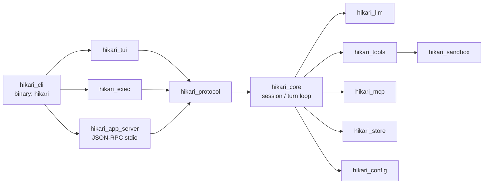

# Hikari Foundation — Tech Spec

## Context

The repository is empty apart from `LICENSE` (MIT). This spec fixes the language, workspace
layout, core architecture, and engineering workflow every later spec builds on. Invariant numbers
refer to `product.md`.

Language: Rust (stable, pinned in `rust-toolchain.toml`). Rationale: no GC and predictable memory
(4), single static binary (1, 2), and first-class native libraries for the agent's hot paths —
`ignore`/`grep-searcher` (ripgrep internals), `tree-sitter`, `similar`, `landlock`, `ratatui`.

## Architecture



### Submission / event queue

The core exposes exactly one interface to every front-end: a session handle that accepts `Op`
submissions and yields an ordered stream of `Event`s. Both types live in `hikari_protocol`, are
`serde`-serializable, and are the payloads the app-server forwards verbatim over JSON-RPC. The TUI
and `exec` link the core in-process but talk to it through the same channel types, so every
surface exercises the same code path (13).

### Crates

| Crate | Responsibility |
|---|---|
| `hikari_protocol` | `Op`, `Event`, ids, approval and tool-call wire types. No I/O. |
| `hikari_features` | `FeatureFlag` enum and runtime gating. |
| `hikari_config` | Layered TOML config (defaults → user → project → CLI flags), provider profiles. |
| `hikari_llm` | `ModelClient` trait, SSE streaming, Anthropic / OpenAI Responses / OpenAI Chat adapters. |
| `hikari_tools` | Built-in tools and the `Tool` trait; risk classification (23). |
| `hikari_sandbox` | Platform sandboxes and the only sanctioned process spawner (24, 25). |
| `hikari_mcp` | MCP client (stdio, streamable HTTP). |
| `hikari_store` | Data dir layout, transcripts, blob store, checkpoints, budget and retention GC (5–10). |
| `hikari_core` | Session, turn loop, context assembly, compaction, approvals, sub-agents, hooks. |
| `hikari_tui` | ratatui front-end. |
| `hikari_exec` | Headless front-end. |
| `hikari_app_server` | JSON-RPC 2.0 over stdio. |
| `hikari_cli` | `hikari` binary: argument parsing and dispatch only. |
| `xtask` | Developer automation (`cargo xtask presubmit` etc.). Not shipped. |

Dependency direction is strictly downward in the table's diagram: front-ends never depend on each
other, and `hikari_protocol` depends on nothing in the workspace.

### Runtime

- `tokio` multi-thread runtime capped at `min(4, num_cpus)` workers; blocking file/search work uses
  `spawn_blocking`.
- HTTP via `reqwest` with `rustls` (no OpenSSL; keeps cross-compilation simple).
- Release profile: `lto = "fat"`, `codegen-units = 1`, `strip = "symbols"`, `opt-level = 3`.

### Storage (5–10)

```
$HIKARI_HOME/
  config.toml
  sessions/<yyyy-mm>/<session-id>.jsonl.zst   append-only event log, zstd frames
  blobs/<aa>/<hash>.zst                        large tool outputs, file checkpoint contents
  index.sqlite                                 session metadata + blob refcounts
```

- Transcript events are flushed as independent zstd frames so a crash loses at most the last frame.
- Blobs are BLAKE3 content-addressed and reference-counted; checkpoints are lists of
  `(path, blob_hash)` for files touched in a turn.
- A budget accountant tracks bytes per category in `index.sqlite`; GC runs at startup (bounded to
  a few ms of work, continued in the background) and whenever a write crosses the budget.

### Context management

Token accounting per provider tokenizer estimate; compaction triggers at a configurable fraction of
the window, summarizing older turns while preserving the system prompt, project instructions,
the active todo list, and the most recent turns verbatim. Provider prompt caching is used where
available (Anthropic `cache_control`, OpenAI automatic caching) by keeping the prefix stable.

## Engineering workflow

Adopted from Warp's development flow (not its technology). See `AGENTS.md` and `CONTRIBUTING.md`.

- Issue first; features need `specs/<id>/product.md` + `tech.md` before code.
- Validation order: targeted `cargo check`/`nextest` while editing → relevant tests → Clippy with
  `-D warnings` → formatter once → PR. Full `cargo xtask presubmit` only when required.
- Unit tests live in `<file>_tests.rs` siblings included via `#[cfg(test)] #[path = ...] mod tests;`.
- Runtime feature flags (`FeatureFlag::X.is_enabled()`) are preferred over `cfg` gates.
- Exhaustive `match` without `_` wildcards where possible.
- PRs use the template with `CHANGELOG-*` lines.
- Automation is `cargo xtask` instead of shell scripts so it runs identically on Windows.

## Milestones

| Milestone | Scope |
|---|---|
| M0 | This spec: workspace, tooling, CI, protocol skeleton, feature flags. |
| M1 | `hikari exec` end-to-end with one provider and read/grep/glob/edit/shell tools (no sandbox). |
| M2 | Store with budget/retention GC, resume, checkpoints/rewind. |
| M3 | TUI, approvals, sandbox on all three OSes. |
| M4 | All three provider protocols, MCP, compaction, AGENTS.md loading. |
| M5 | App-server, sub-agents, hooks, skills, custom commands; parity review against Claude Code. |

## Testing and validation

- Footprint invariants (2–4) are checked by a CI job that builds release binaries and records size,
  `--version` latency, and idle RSS, failing on regression past the budget.
- Storage invariants (5–10) get property tests over simulated sessions with a tiny budget.
- Provider adapters are tested against recorded SSE fixtures; no network in unit tests.
- Front-ends get render-to-lines snapshot tests (TUI) and golden JSONL tests (`exec --json`).

## Risks

- Sandbox parity on Windows is the least mature; M3 may ship Windows with a weaker policy behind a
  feature flag.
- Matching "effect" parity depends mostly on prompts and tool design, not language; that work needs
  an eval harness (separate spec).
